# Article outline

**Scope:** revisit the dataset relevance framework of Fuster-Calvo et al. (2025) with large language models (LLMs) in place of the bag-of-words classifier. The article compares two ways of scoring dataset relevance and asks which input text (short or long) and which model each one needs.

**Central question:** is relevance classification better treated as an interpretable, structured decision process, or can an LLM approximate the whole decision directly?

Either answer is a result:
- if direct LLM scoring is accurate, the model can absorb the prioritization logic, and can be used when feature extraction is incomplete or the full article is not available;
- if it is not, explicit ecological criteria with transparent weighting are more robust and reproducible than an LLM alone.

---

## 1. The two approaches

1. **Relevance scoring from rules applied to extracted features.** The LLM extracts structured features (data type, taxa, temporal and spatial extent, modulator flags). The relevance rules of Fuster-Calvo et al. are then applied in code to produce the relevance category.
2. **Relevance scoring from rules given to the LLM (direct scoring).** The relevance rules and the Biodiversité Québec priorities are written into the instructions. The LLM returns the relevance category directly.

**Interpretation**
- The two approaches trade off differently:
  - **Rule-based scoring:** every decision is traceable to a rule, and the rules can change over time without re-running the extraction (for example, if high-richness datasets are no longer a priority).
  - **Direct scoring:** simpler. It does not need the feature-by-feature prompt engineering that accurate extraction of species, location and data type requires.
- A third variant sits between them: one call that extracts the features **and** gives the relevance category.
- Applying the rules to the human-annotated features reproduces the original relevance categories exactly. This validates the rule implementation, so any loss of performance in approach 1 comes from extraction, not from the rules.

---

## 2. Introduction

- **The original workflow** of Fuster-Calvo et al.: features and modulators → classification → evaluation. Its main bottleneck is that spatial and temporal metadata are often missing from abstracts and repository descriptions.
- **The proposed workflow:** LLM-based feature extraction, followed by rule-based scoring or direct scoring.
- **Literature:** LLMs for metadata extraction and for processing scientific documents. Also how other fields build gold-standard annotated datasets, and the choice between instructing a general model and feeding it annotated examples.
- **Goals:**
  - extract ecological metadata from scientific documents with LLMs, comparing short and long text, against manual annotations (precision, recall, F1);
  - compare relevance classification with the manual and automated results of Fuster-Calvo et al.

### Framing (to be discussed)

- **Context:** biodiversity observation networks need data that covers taxa, regions and periods well enough to track progress toward the Kunming-Montreal Global Biodiversity Framework. Many useful datasets are known only through unstructured text, so taxonomic, spatial and temporal gaps stay hidden.
- **Motivation:** help identify, from extracted features, which datasets can feed the indicators and analyses of Biodiversité Québec. This is stated as motivation and outlook, not as a goal the article tests.
- **End-to-end flow:** the introduction sketches the full flow the work fits into:
  - datasets and papers harvested from Dryad, Zenodo and Semantic Scholar;
  - features extracted from them;
  - features matched against the data need of an indicator;
  - candidate datasets that support a decision.

  Only the extraction and relevance scoring steps are evaluated. The case study, if kept, illustrates one pass through the full flow.
- **Points to settle:**
  - how much of the flow to show (one or two sentences, or an outer band on Figure 1);
  - how an indicator's data need is written as explicit criteria (taxa, region, period, data type), which then act as the rule set for rule-based scoring.

---

## 3. Methods

### Data
- Manual annotations of Fuster-Calvo et al., from three sources: Dryad, Zenodo and Semantic Scholar.
- Annotation context, from the feature `*_location` values: abstract only, full text, or the dataset itself.
- Main counts: valid records, records with a PDF, share that is open access.
- **Scope:**
  - only records annotated as valid. Records the search returned but that were judged off-topic (non-biodiversity datasets) are excluded from performance;
  - only open-access records for the full-text conditions: the PDFs come from open-access sources, and the counts reported per condition include open-access PDFs only.

### Inputs: short vs long text
- **Short text:** the dataset abstract or the data paper (repository) description.
- **Long text:** the full article, either the PDF file given to the model or its parsed sections.

### LLM tasks
1. Feature extraction (approach 1).
2. Feature extraction and scoring in the same call (the intermediate variant).
3. Scoring only (approach 2).

### Prompt engineering
- An iterative loop on the instructions: a baseline prompt, then one change at a time, each judged against the baseline on a fixed evaluation subset.
- Blocks tuned: controlled vocabularies (data type, geospatial information), modulator cues, and rules specific to each input mode.
- This step deserves its own section. It is what makes approach 1 work, and approach 2 avoids it.

### Evaluation
- The LLM output and the ground truth go through the **same data model** (the Pydantic schemas). Both are normalized the same way before comparison: vocabulary mapping, list splitting, placeholder removal.
- Per-field matching strategies: exact for categories, years and booleans; name-aware fuzzy matching for species.
- Metrics: precision, recall, F1, and confusion matrices. Relevance is scored both as binary (relevant vs not) and four-class (high, moderate, low, not relevant).

---

## 4. Figures

### Figure 1: conceptual workflow
Inputs (article PDF, abstract or data paper description) → LLM with instructions and model choice → one of the three tasks → structured output → evaluation against the normalized ground truth → outcomes (confusion matrix, precision, recall, F1).

```
                        Instructions (prompt engineering) ◄──────┐
                                     │                           │ iterate
                                     ▼                           │
 ┌──────────────────┐       ┌─────────────────────────┐          │
 │ Article PDF      │──┐    │ LLM  (model choice)     │          │
 │  (long text)     │  │    │                         │    ┌─────┴──────────────┐
 ├──────────────────┤  │    │ 1. Feature extraction   │    │ Structured output  │
 │ Abstract         │──┼OR─▶│ 2. Extraction + scoring │───▶│ { features }  or   │
 ├──────────────────┤  │    │ 3. Scoring only         │    │ relevance category │
 │ Data paper       │──┘    └─────────────────────────┘    └─────────┬──────────┘
 │  description     │                                                │
 │  (short text)    │                                      same data model
 └──────────────────┘                                                │
                                                                     ▼
 ┌──────────────────┐       ┌─────────────────┐            ┌──────────────────┐     ┌──────────────────┐
 │ Ground truth     │──────▶│ Normalization   │───────────▶│    Evaluation    │────▶│ Confusion matrix │
 │ (manual          │       │ (same data      │            │                  │     │ Precision        │
 │  annotations)    │       │  model)         │            │                  │     │ Recall, F1       │
 └──────────────────┘       └─────────────────┘            └──────────────────┘     └──────────────────┘
```

**Interpretation:** the reader's map of the study. It shows that both approaches share the inputs, the data model and the evaluation, and differ only in what the LLM is asked to return.

### Figure 2: method clarification
The anatomy of one LLM call:
- model and parameters, including reasoning effort;
- instructions that provide context (system prompt);
- user input (the document text);
- output.

It shows how these differ between feature extraction and direct scoring.

```
   Approach 1: rules on extracted features        Approach 2: direct scoring

 ┌─────────────────────────────────────┐        ┌─────────────────────────────────────┐
 │ Model + parameters                  │        │ Model + parameters                  │
 │ (reasoning effort)                  │        │ (reasoning effort)                  │
 ├─────────────────────────────────────┤        ├─────────────────────────────────────┤
 │ Instructions (system prompt)        │        │ Instructions (system prompt)        │
 │ persona, vocabularies, extraction   │        │ relevance rules + Biodiversité      │
 │ rules per field                     │        │ Québec priorities                   │
 ├─────────────────────────────────────┤        ├─────────────────────────────────────┤
 │ User input: document text           │        │ User input: document text           │
 └──────────────────┬──────────────────┘        └──────────────────┬──────────────────┘
                    ▼                                              ▼
              { features }                                 relevance category
                    │                                      (high / moderate /
                    ▼                                       low / not relevant)
        relevance rules applied in code
                    │
                    ▼
            relevance category
```

**Interpretation:** an explainer for an ecology audience. It defines the terms used in Methods ("prompt", "instructions", "reasoning effort") and makes clear where the relevance rules live: in code for approach 1, in the instructions for approach 2.

A small inset can contrast the two routes. Rule-based scoring must go through extracted taxa, its weakest feature; direct scoring bypasses that step.

```
 Rule-based scoring:  text ──▶ features ──▶ taxa ──▶ rules ──▶ category
                                             ▲
                                       weakest step

 Direct scoring:      text ──────────────────────────────────▶ category
```

---

## 5. Tables

### Table 1: relevance scoring performance (main)

| Approach | Short text (abstract / data paper description) | Long text (article PDF) |
|---|---|---|
| 1. Rules on extracted features | P, R, F1 | P, R, F1 |
| 2. Direct LLM scoring | P, R, F1 | P, R, F1 |

Reference row: the supervised bag-of-words classifier of Fuster-Calvo et al. (F1 0.67).

**Interpretation:** the headline result. Long text helps both approaches. Direct scoring is weak on short text, but on PDFs it outperforms the original classifier on the binary task. Differences in corpus size, target definition and evaluation protocol rule out a strict benchmark claim against the original paper.

### Table 2: feature extraction performance (main)

| Approach | EBV features (P, R, F1) | Modulators (P, R, F1) |
|---|---|---|
| 1. Rules on extracted features | … | … |

- **EBV features:** data type, species, temporal range (start and end year), spatial range, geospatial information type, time series.
- **Modulators:** multispecies, threatened species, new species to science, new species to the region, north–south bias.

Split by input (abstract, sections, PDF).

| Abstract / data paper description | Article PDF |
|---|---|
| 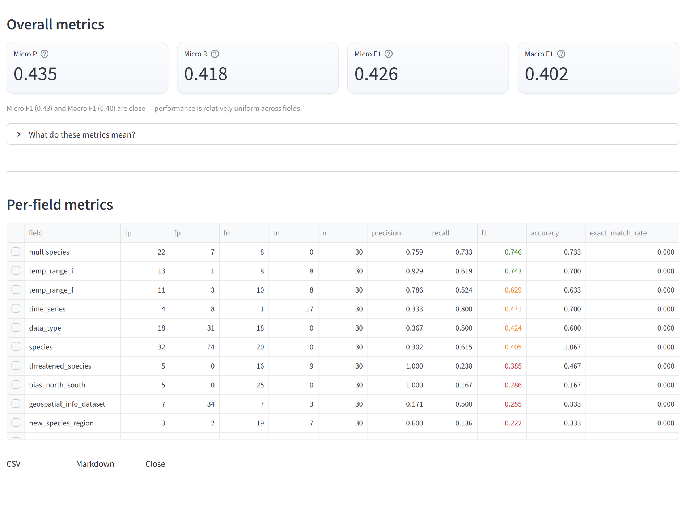 | 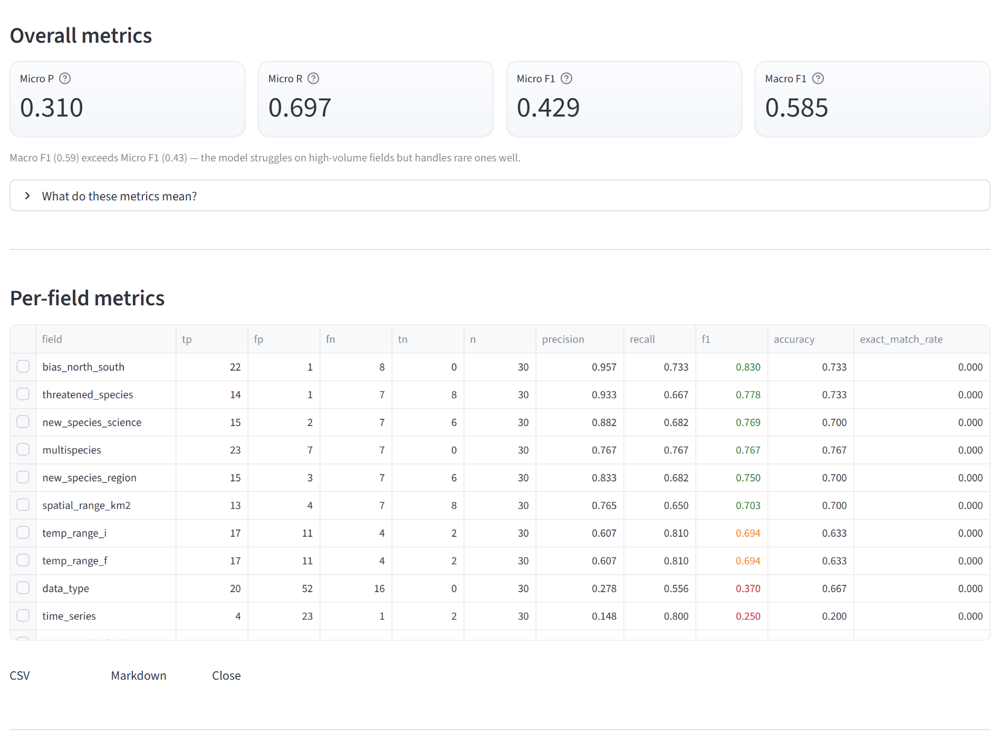 |

*Per-field precision, recall and F1 from the results app: improved prompt, gpt-5-mini at low reasoning effort. The app table shows 10 of the 12 fields.*

*⚠️ Only 30 records (the evaluation subset: 10 Dryad, 10 Zenodo, 10 Semantic Scholar, all open access). Indicative, not final results.*

**Interpretation:** only approach 1 has features to evaluate. The table shows where extraction fails, which explains the gap between short and long text in Table 1. Under sparse metadata, extraction rather than rule design is the main failure point.

### Table 3: confusion matrices (optional)
Predicted vs true relevance category, per approach and input.

| | Short text | Article PDF |
|---|---|---|
| Rules on extracted features | 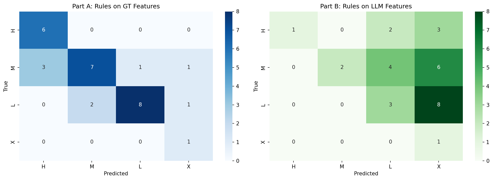 | 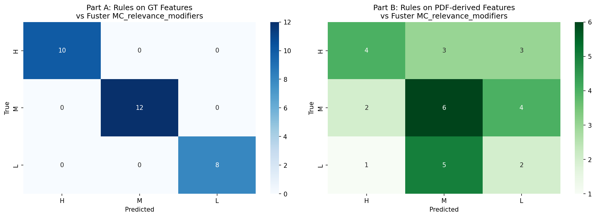 |
| Direct LLM scoring | 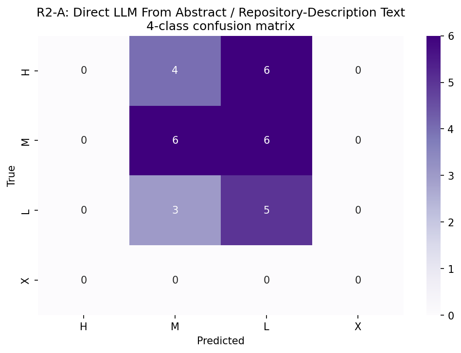 | 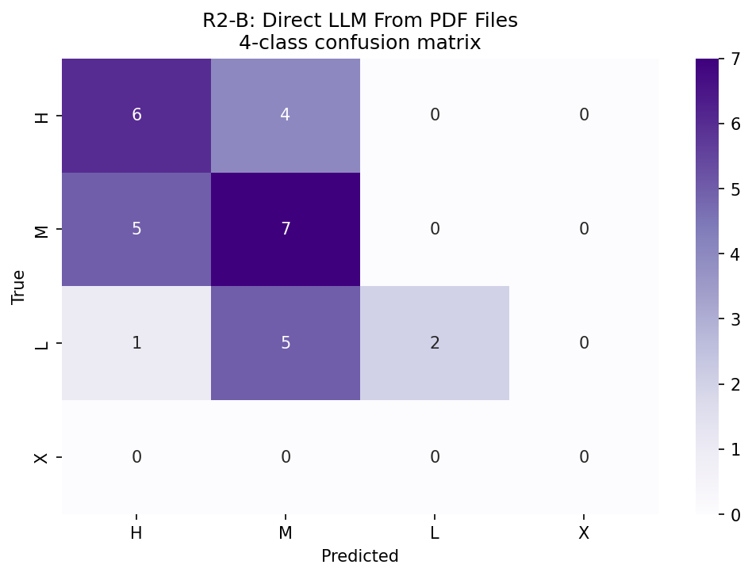 |

*True vs predicted relevance category (H = high, M = moderate, L = low, X = not relevant), from the relevance notebooks; the results app has no relevance view. In the rule-based images, the left panel applies the rules to the human-annotated features (the ceiling check) and the right panel applies them to extracted features.*

*⚠️ Only 30 records (the evaluation subset). Indicative, not final results.*

**Interpretation:** shows whether each method overrates or underrates relevance. Together with Table 2, it shows which criteria (species, data type, spatial, temporal) the LLM describes well or poorly, and what bias that brings to prioritization.

### Table 4: model quality (optional)
Relevance scoring performance across models and reasoning effort, with a repeatability check (a fresh run vs a cached run).

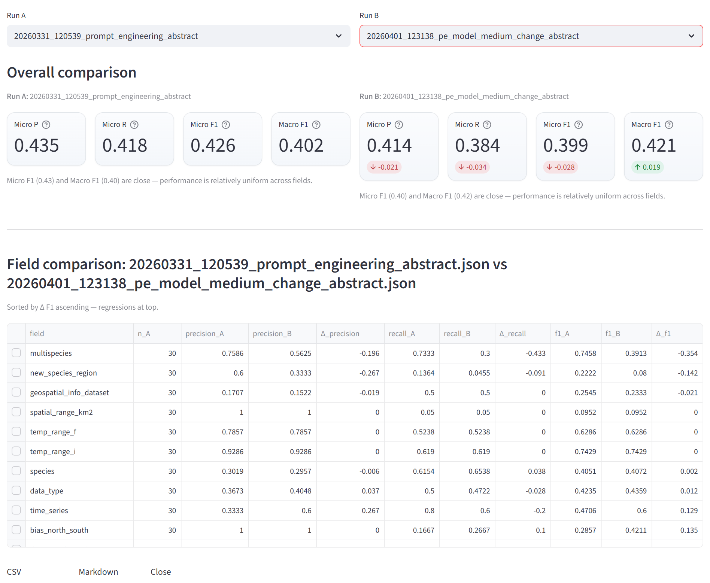

*Feature extraction from abstracts, gpt-5-mini at low reasoning effort (run A) vs gpt-5.4 at medium effort (run B), from the results app. Fields are sorted by the change in F1, regressions first.*

*⚠️ Only 30 records (the evaluation subset). Indicative, not final results. Model effect on relevance scoring itself is not measured yet.*

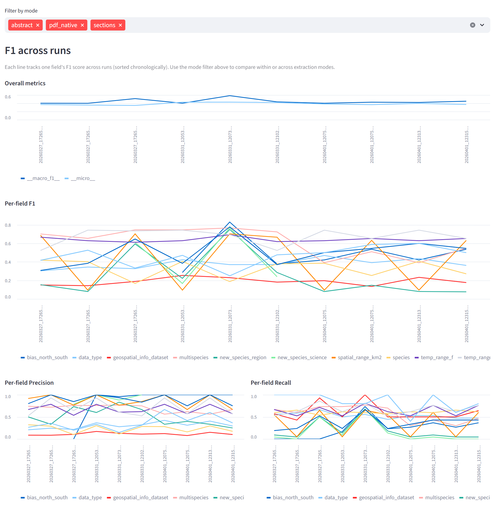

*Per-field F1, precision and recall across all runs in chronological order, all input modes mixed, from the results app.*

*⚠️ Only 30 records per run (the evaluation subset). Indicative, not final results.*

**Interpretation:** tests whether the conclusions hold across models, and how much a stronger model narrows the gap between approaches.

---

## 6. Supplementary material

### S1: taxa extraction
Species extraction is the weakest feature. The supplement documents the failure modes: decorated strings, counts, broad groups, vernacular vs scientific names, and focal vs incidental taxa. It also covers the name-aware matching used to evaluate them.

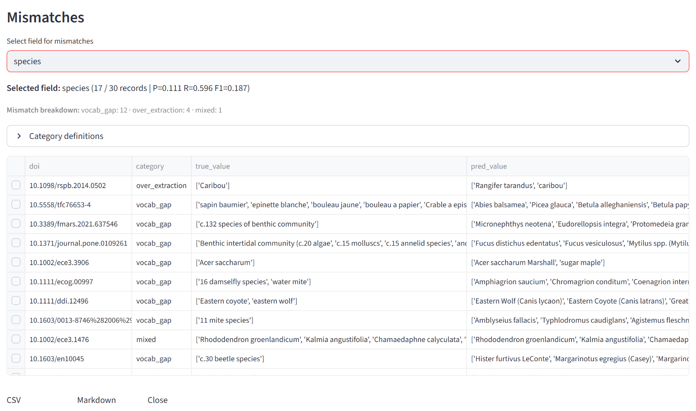

*Species mismatches from PDF input, with their likely cause (vocabulary gap, over-extraction, mixed), from the results app: improved prompt, gpt-5-mini at low reasoning effort.*

*⚠️ Only 30 records (the evaluation subset), 17 of which have a species mismatch. Indicative, not final results.*

**Interpretation:** this keeps a technical weakness out of the main text while explaining why rule-based scoring suffers where taxa matter, and why direct scoring can do better there.

### S2: cost per approach
Tokens and cost in US dollars per record, for each approach and input (short text, PDF), and the cost of scaling to a full repository harvest.

| Abstract / data paper description | Article PDF |
|---|---|
| 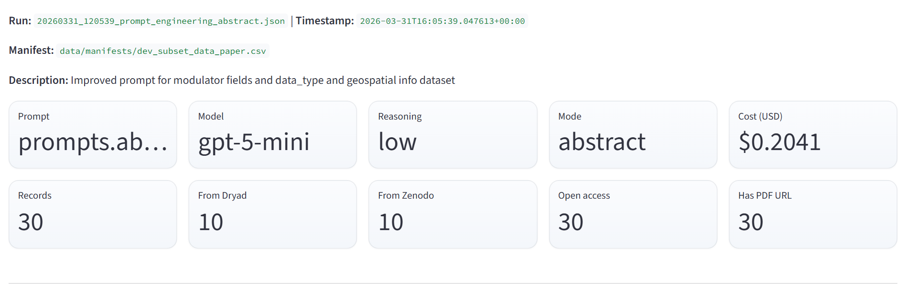 | 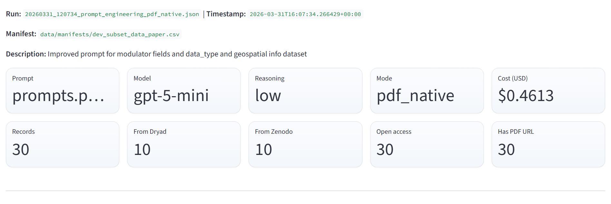 |

*Total cost of one feature extraction run (Cost tile, US dollars), from the results app: improved prompt, gpt-5-mini at low reasoning effort.*

*⚠️ Only 30 records (the evaluation subset). Divide by 30 for the cost per record; it does not cover relevance scoring calls.*

**Interpretation:** long text and stronger models cost more. This supplement lets a reader weigh the performance gains in Table 1 against the cost of running each approach at Biodiversité Québec's scale.

### S3: data gaps (to be discussed)
Coverage of Biodiversité Québec data by taxonomic group (and possibly by region and period), against the expected diversity.

**Interpretation:** it grounds the motivation in real numbers by showing which gaps the extracted features could help fill. Including it requires figures computed from the Atlas data.

---

## 7. Case study (to be discussed)

**Insects in northern Quebec:** apply the pipeline to a real priority-gap question, finding candidate datasets for insect monitoring in the North.

**Interpretation:** turns the benchmark into a use case for Biodiversité Québec. Whether to include it is still open.

---

## 8. Results and discussion themes

- Gains from prompt engineering (baseline vs improved prompt).
- Short vs long text: performance, cost (detailed in S2) and repeatability.
- Reproducibility: cached calls and fixed evaluation subsets make runs repeatable; a fresh run vs a cached run measures how stable the model is.
- Per-field insights: location and time benefit from full text; species is hard everywhere.
- Rule-based vs direct scoring: transparency and evolving rules vs simplicity and robustness to missing features.
- Comparison with the NLP classification of Fuster-Calvo et al. The main challenge is not defining relevance but recovering the metadata needed to apply that definition. Direct LLM scoring works best when full text is available.
- How to improve the benchmark dataset and the extraction.
- Benefits, limits and outlook for LLM-based extraction at Biodiversité Québec.
- A demo front end for exploring the extraction results.

---

## 9. Current status

| Element | Status |
|---|---|
| Table 1, four cells | Done (rule-based and direct scoring, each on short and long text) |
| Table 2, EBV features + modulators | Done on the 30-record evaluation subset. Not run on the full corpus |
| Intermediate task (extraction and scoring in one call) | Not started |
| Table 3, confusion matrices | Partly done (four-class results exist; no figure yet) |
| Table 4, model quality | Partly done (one stronger-model run and a repeatability test) |
| S1, taxa extraction | Analysis exists; dedicated species prompt block still open |
| S2, cost per approach | Cost tracked for every call in every run; table not assembled |
| S3, data gaps | Placeholder figure only; needs real Atlas data; inclusion to be discussed |
| Open-access-only counts for full text | To check: confirm every PDF used in the full-text conditions is open access |
| Figures 1 and 2 | Not started |
| Insect case study | Not started; inclusion to be discussed |
| Introduction and Discussion | Being drafted by Alex Fuster |

---

## Out of scope

- **Embedding-based retrieval** (chunk embeddings and a vector database to select relevant passages before extraction). It was explored, but the full-text conditions use the whole PDF or its parsed sections instead.

---

## Sources

- **Whiteboard session with Alex Fuster, 21 April 2026.** It set the structure of figures, tables and supplementary material, the two approaches and the three LLM tasks, and the case study idea. A detailed transcription is in [`article_whiteboard_outline_20260421.md`](article_whiteboard_outline_20260421.md).
- **The decision to present both approaches** (rather than direct GPT scoring alone), agreed by Alex Fuster and Dominique Gravel, email of 17 April 2026.
- **The framing of the central question** and the idea of direct scoring: Alex Fuster's email of 29 March 2026. The trade-offs between the approaches: email of 14 April 2026.
- **Results and draft wording:** [`plans/automated_relevance_classification.md`](../plans/automated_relevance_classification.md) and [`relevance_classification_comparison_draft.md`](relevance_classification_comparison_draft.md).
- **Feature extraction runs and prompt iteration:** `notebooks/README.md` (entries from 27 March to 10 April 2026).
- **The status table** reflects the repository as of its last commit, 10 April 2026.
- **Reference:** Fuster-Calvo A, Valentin S, Tamayo WC, Gravel D. 2025. Evaluating the feasibility of automating dataset retrieval for biodiversity monitoring. *PeerJ* 13:e18853. https://doi.org/10.7717/peerj.18853
