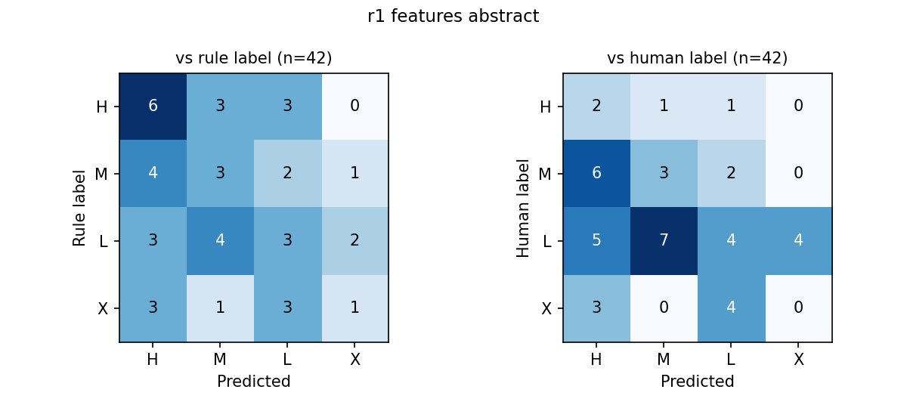
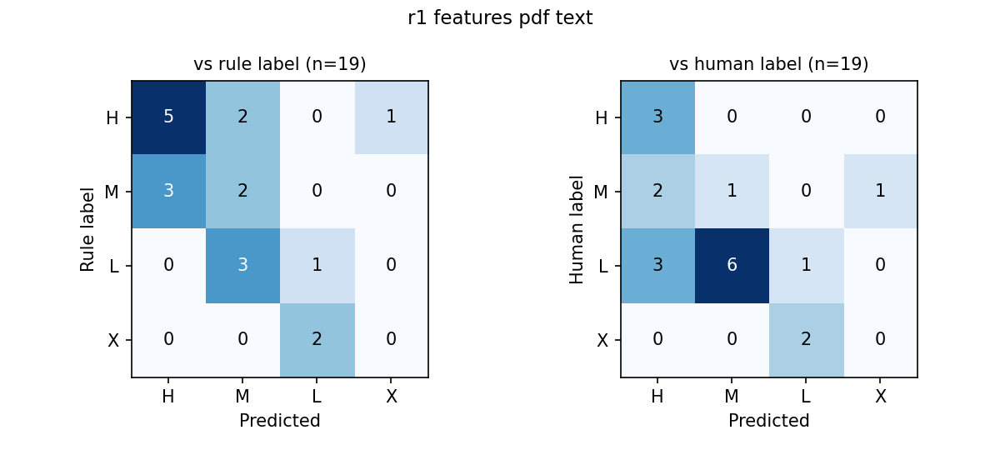
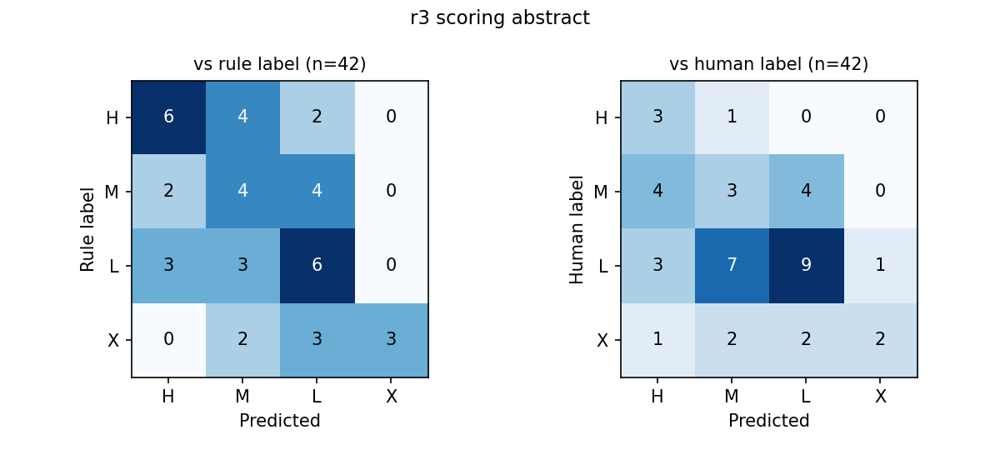
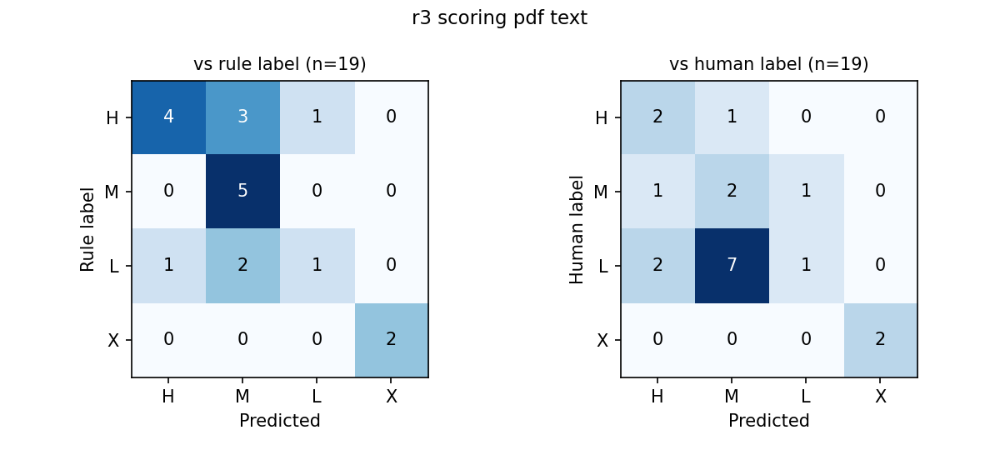
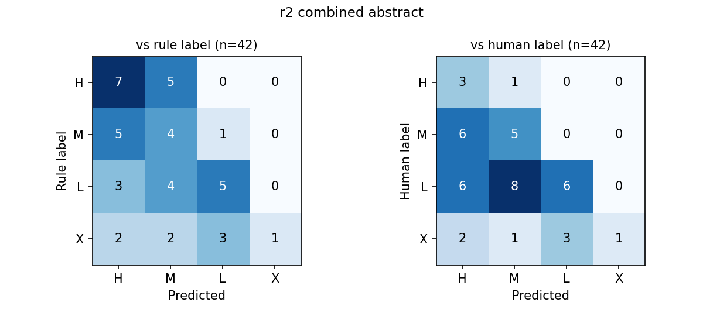
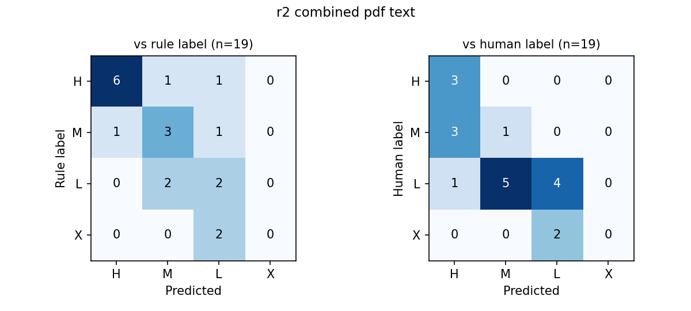
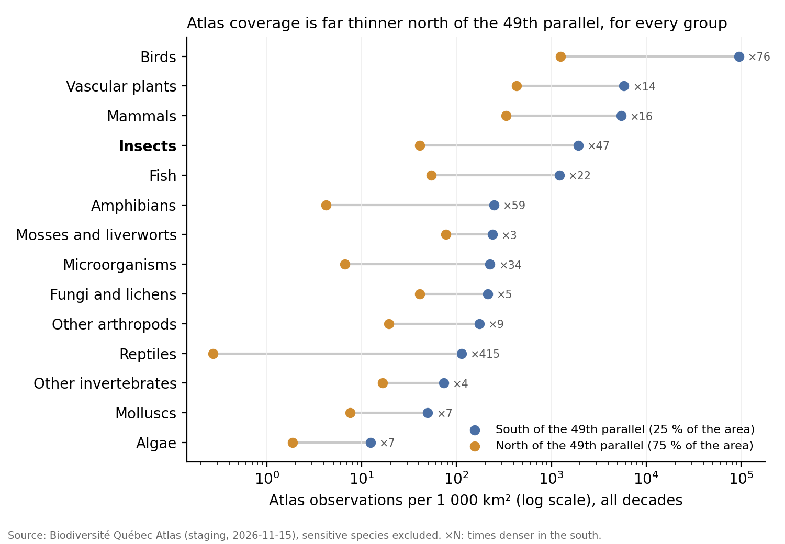

# Article outline

**Scope:** revisit the dataset relevance framework of Fuster-Calvo et al. (2025) with large language models (LLMs) in place of the bag-of-words classifier. The article compares two ways of scoring dataset relevance and asks which input text (short or long) and which model each one needs.

**Central question:** is relevance classification better treated as an interpretable, structured decision process, or can an LLM approximate the whole decision directly?

Either answer is a result:
- if direct LLM scoring is accurate, the model can absorb the prioritization logic, and can be used when feature extraction is incomplete or the full article is not available;
- if it is not, explicit ecological criteria with transparent weighting are more robust and reproducible than an LLM alone.

---

## 1. The two approaches

1. **Relevance scoring from rules applied to extracted features.** The LLM extracts structured features (data type, taxa, temporal and spatial extent, modulator flags). The relevance rules of Fuster-Calvo et al. are then applied in code to produce the relevance category.
2. **Relevance scoring from rules given to the LLM (direct scoring).** The relevance rules and the Biodiversité Québec priorities are written into the instructions. The LLM returns the relevance category directly.

**Interpretation**
- The two approaches trade off differently:
  - **Rule-based scoring:** every decision is traceable to a rule, and the rules can change over time without re-running the extraction (for example, if high-richness datasets are no longer a priority).
  - **Direct scoring:** simpler. It does not need the feature-by-feature prompt engineering that accurate extraction of species, location and data type requires.
- A third variant sits between them: one call that extracts the features **and** gives the relevance category.
- Applying the rules to the human-annotated features reproduces the original relevance categories exactly. This validates the rule implementation, so any loss of performance in approach 1 comes from extraction, not from the rules.

---

## 2. Introduction

- **The original workflow** of Fuster-Calvo et al.: features and modulators → classification → evaluation. Its main bottleneck is that spatial and temporal metadata are often missing from abstracts and repository descriptions.
- **The proposed workflow:** LLM-based feature extraction, followed by rule-based scoring or direct scoring.
- **Literature:** LLMs for metadata extraction and for processing scientific documents. Also how other fields build gold-standard annotated datasets, and the choice between instructing a general model and feeding it annotated examples.
- **Goals:**
  - extract ecological metadata from scientific documents with LLMs, comparing short and long text, against manual annotations (precision, recall, F1);
  - compare relevance classification with the manual and automated results of Fuster-Calvo et al.

### Framing (to be discussed)

- **Context:** biodiversity observation networks need data that covers taxa, regions and periods well enough to track progress toward the Kunming-Montreal Global Biodiversity Framework. Many useful datasets are known only through unstructured text, so taxonomic, spatial and temporal gaps stay hidden.
- **Motivation:** help identify, from extracted features, which datasets can feed the indicators and analyses of Biodiversité Québec. This is stated as motivation and outlook, not as a goal the article tests.
- **End-to-end flow:** the introduction sketches the full flow the work fits into:
  - datasets and papers harvested from Dryad, Zenodo and Semantic Scholar;
  - features extracted from them;
  - features matched against the data need of an indicator;
  - candidate datasets that support a decision.

  Only the extraction and relevance scoring steps are evaluated. The case study, if kept, illustrates one pass through the full flow.
- **Points to settle:**
  - how much of the flow to show (one or two sentences, or an outer band on Figure 1);
  - how an indicator's data need is written as explicit criteria (taxa, region, period, data type), which then act as the rule set for rule-based scoring.

---

## 3. Methods

### Data
- Manual annotations of Fuster-Calvo et al., from three sources: Dryad, Zenodo and Semantic Scholar.
- Annotation context, from the feature `*_location` values: abstract only, full text, or the dataset itself.
- Main counts: valid records, records with a PDF, share that is open access.
- **Scope:**
  - only records annotated as valid. Records the search returned but that were judged off-topic (non-biodiversity datasets) are excluded from performance;
  - only open-access records for the full-text conditions: the PDFs come from open-access sources, and the counts reported per condition include open-access PDFs only.

### Inputs: short vs long text
- **Short text:** the dataset abstract or the data paper (repository) description.
- **Long text:** the full article, either the PDF file given to the model or its parsed sections.

### LLM tasks
1. Feature extraction (approach 1).
2. Feature extraction and scoring in the same call (the intermediate variant).
3. Scoring only (approach 2).

### Prompt engineering
- An iterative loop on the instructions: a baseline prompt, then one change at a time, each judged against the baseline on a fixed evaluation subset.
- Blocks tuned: controlled vocabularies (data type, geospatial information), modulator cues, and rules specific to each input mode.
- This step deserves its own section. It is what makes approach 1 work, and approach 2 avoids it.

### Evaluation
- The LLM output and the ground truth go through the **same data model** (the Pydantic schemas). Both are normalized the same way before comparison: vocabulary mapping, list splitting, placeholder removal.
- Per-field matching strategies: exact for categories, years and booleans; name-aware fuzzy matching for species.
- Metrics: precision, recall, F1, and confusion matrices. Relevance is scored both as binary (relevant vs not) and four-class (high, moderate, low, not relevant).

---

## 4. Figures

### Figure 1: conceptual workflow
Inputs (article PDF, abstract or data paper description) → LLM with instructions and model choice → one of the three tasks → structured output → evaluation against the normalized ground truth → outcomes (confusion matrix, precision, recall, F1).

```
                        Instructions (prompt engineering) ◄──────┐
                                     │                           │ iterate
                                     ▼                           │
 ┌──────────────────┐       ┌─────────────────────────┐          │
 │ Article PDF      │──┐    │ LLM  (model choice)     │          │
 │  (long text)     │  │    │                         │    ┌─────┴──────────────┐
 ├──────────────────┤  │    │ 1. Feature extraction   │    │ Structured output  │
 │ Abstract         │──┼OR─▶│ 2. Extraction + scoring │───▶│ { features }  or   │
 ├──────────────────┤  │    │ 3. Scoring only         │    │ relevance category │
 │ Data paper       │──┘    └─────────────────────────┘    └─────────┬──────────┘
 │  description     │                                                │
 │  (short text)    │                                      same data model
 └──────────────────┘                                                │
                                                                     ▼
 ┌──────────────────┐       ┌─────────────────┐            ┌──────────────────┐     ┌──────────────────┐
 │ Ground truth     │──────▶│ Normalization   │───────────▶│    Evaluation    │────▶│ Confusion matrix │
 │ (manual          │       │ (same data      │            │                  │     │ Precision        │
 │  annotations)    │       │  model)         │            │                  │     │ Recall, F1       │
 └──────────────────┘       └─────────────────┘            └──────────────────┘     └──────────────────┘
```

**Interpretation:** the reader's map of the study. It shows that both approaches share the inputs, the data model and the evaluation, and differ only in what the LLM is asked to return.

### Figure 2: method clarification
The anatomy of one LLM call:
- model and parameters, including reasoning effort;
- instructions that provide context (system prompt);
- user input (the document text);
- output.

It shows how these differ between feature extraction and direct scoring.

```
   Approach 1: rules on extracted features        Approach 2: direct scoring

 ┌─────────────────────────────────────┐        ┌─────────────────────────────────────┐
 │ Model + parameters                  │        │ Model + parameters                  │
 │ (reasoning effort)                  │        │ (reasoning effort)                  │
 ├─────────────────────────────────────┤        ├─────────────────────────────────────┤
 │ Instructions (system prompt)        │        │ Instructions (system prompt)        │
 │ persona, vocabularies, extraction   │        │ relevance rules + Biodiversité      │
 │ rules per field                     │        │ Québec priorities                   │
 ├─────────────────────────────────────┤        ├─────────────────────────────────────┤
 │ User input: document text           │        │ User input: document text           │
 └──────────────────┬──────────────────┘        └──────────────────┬──────────────────┘
                    ▼                                              ▼
              { features }                                 relevance category
                    │                                      (high / moderate /
                    ▼                                       low / not relevant)
        relevance rules applied in code
                    │
                    ▼
            relevance category
```

**Interpretation:** an explainer for an ecology audience. It defines the terms used in Methods ("prompt", "instructions", "reasoning effort") and makes clear where the relevance rules live: in code for approach 1, in the instructions for approach 2.

A small inset can contrast the two routes. Rule-based scoring must go through extracted taxa, its weakest feature; direct scoring bypasses that step.

```
 Rule-based scoring:  text ──▶ features ──▶ taxa ──▶ rules ──▶ category
                                             ▲
                                       weakest step

 Direct scoring:      text ──────────────────────────────────▶ category
```

---

## 5. Tables

**Setting for every table unless stated otherwise:**
- **Model:** Claude Haiku 5.5 at low reasoning effort, with the prompts frozen after five rounds on the 30-record development subset.
- **Data:** the **held-out set**, the 68 valid open-access records never used for tuning, run once ([`configs/final_heldout.json`](../configs/final_heldout.json)).
- **Labels:** 42 of the 68 records carry a relevance label; 19 of the 31 with an open PDF do. The other 26 are annotated "No dataset" (24) or "can't access" (2).
- **Intervals:** 95 % bootstrap over records.
- **Traceability:** every number comes from [`docs/results/heldout_tables/tables.json`](results/heldout_tables/tables.json), which names the run file behind it.

### Table 1: relevance scoring performance (main)

Approaches:
- **1. Rules on extracted features:** the LLM extracts the features; the Fuster rules run in code.
- **2. Scoring only:** the rules are in the instructions; the LLM returns the category alone.
- **2b. Combined:** the intermediate variant, features and category in one call.

Targets:
- **Rule label:** the Fuster rules applied to the human features; primary.
- **Human label:** the annotator's own judgement.

Binary: relevant = high or moderate.

| Approach | Input | n | Binary F1, rule label | Four-class agreement, rule label | Binary F1, human label | Four-class agreement, human label |
|---|---|---|---|---|---|---|
| 1. Rules on extracted features | Short text | 42 | 0.65 [0.49, 0.79] | 0.31 [0.19, 0.45] | 0.57 [0.36, 0.74] | 0.21 [0.10, 0.36] |
| 1. Rules on extracted features | Long text (PDF text) | 19 | 0.86 [0.67, 0.97] | 0.42 [0.21, 0.63] | 0.55 [0.25, 0.78] | 0.26 [0.11, 0.47] |
| 1. Rules on extracted features | Long text (native PDF) | 19 | 0.86 [0.69, 0.97] | 0.47 [0.21, 0.68] | 0.64 [0.33, 0.83] | 0.32 [0.11, 0.53] |
| 1. Rules on extracted features | Long text (sections) | 19 | 0.86 [0.67, 0.97] | 0.21 [0.05, 0.42] | 0.55 [0.25, 0.76] | 0.16 [0.00, 0.32] |
| 2. Scoring only | Short text | 42 | 0.70 [0.51, 0.83] | 0.45 [0.31, 0.60] | 0.56 [0.34, 0.73] | 0.40 [0.26, 0.55] |
| 2. Scoring only | Long text (PDF text) | 19 | 0.86 [0.67, 0.97] | 0.63 [0.42, 0.84] | 0.55 [0.25, 0.78] | 0.37 [0.16, 0.58] |
| 2b. Combined | Short text | 42 | 0.78 [0.64, 0.89] | 0.40 [0.26, 0.55] | 0.64 [0.45, 0.78] | 0.36 [0.21, 0.50] |
| 2b. Combined | Long text (PDF text) | 19 | 0.85 [0.67, 0.97] | 0.58 [0.37, 0.79] | 0.70 [0.40, 0.90] | 0.42 [0.21, 0.63] |
| *Ceiling: rule label vs human label* | | 42 | *binary agreement 74 %, κ 0.48* | *52 %, κ 0.36* | | |

Reference rows, not a strict benchmark (different corpus, target and protocol):
- **Supervised bag-of-words classifier** of Fuster-Calvo et al.: F1 0.67.
- **OpenAI, April 2026** (gpt-5-mini, the same 30 dev records used for tuning), binary F1 against the rule label:
  - rules on extracted features: 0.53 (short text) and 0.71 (PDF);
  - combined: 0.55 (short text) and 0.88 (PDF).

  The April "direct" rows were in fact the combined variant: the prompt asked for the features and the category.

**What survives the paired comparisons (same records, same bootstrap draw):**
- **Combined beats rules on features on short text:** binary F1 +0.12 [+0.03, +0.24] (n = 42).
- **Scoring only beats rules on features on four-class agreement with the human label:** +0.19 [+0.02, +0.36] (short text).
- **Long text vs short text:** on the 19 records with a PDF, long text adds about +0.09 binary F1 for each approach, never clearly. The unpaired rows overstate the gain: the records with an open PDF are easier (rules on short text reach 0.77 on those 19, 0.65 on all 42).
- **Native PDF vs PDF text:** no difference.

**Interpretation:**
- **Short text:** the LLM given the rules does better than rules applied in code to features extracted from the same text. The extracted features are incomplete, and the one-call variants appear to compensate.
- **Long text:** all approaches converge, at about 0.86 binary F1 against the rule label, at or above the bag-of-words reference.
- **Two ceilings:**
  - Every LLM approach agrees less with the human judgement than the rules do: binary F1 0.55–0.70, while the human and rule labels agree on 74 % of records.
  - On four classes, no approach goes beyond the human–rule agreement of 52 %.
- **What limits relevance scoring:** less the choice of approach than (i) the features absent from short text and (ii) a target that experts themselves apply inconsistently.

### Table 2: feature extraction performance (main)

F1 per field and input, held-out set (68 abstracts; 31 PDFs). P / R and intervals in [`table2_features.md`](results/heldout_tables/table2_features.md).

| Field | Short text | PDF text | Native PDF | Sections |
|---|---|---|---|---|
| Data type | 0.23 | 0.26 | 0.30 | 0.26 |
| Geospatial information | 0.14 | 0.14 | 0.15 | 0.11 |
| Taxa, exact taxon (GBIF, capped) | 0.66 | 0.46 | 0.49 | 0.59 |
| Taxa, broad group | 0.79 | 0.74 | 0.75 | 0.80 |
| Taxa, fuzzy string (as in April) | 0.36 | 0.35 | 0.35 | 0.50 |
| Temporal range, class | 0.41 | 0.65 | 0.64 | 0.65 |
| Spatial range, class | 0.47 | 0.60 | 0.72 | 0.54 |
| Time series (flag) | 0.29 | 0.00 | 0.00 | 0.00 |
| Multispecies (flag) | 0.43 | 0.38 | 0.38 | 0.38 |
| North–south (flag) | 0.60 | 0.53 | 0.44 | 0.25 |
| Threatened species, new species (flags) | no true case predicted correctly | | | |
| Micro average (primary fields) | 0.28 | 0.34 | 0.35 | 0.38 |

Scoring choices:
- Yes/no fields are scored as flags: "not stated" counts as false, and only true is a positive, as in the rules.
- Spatial and temporal extent are scored at the class level used by the rules. Exact km² is almost never right, and the rules do not need it.

**Interpretation:**
- **Long text recovers what short text lacks: temporal and spatial extent.** On short text the evidence often is not there. For the start year, the annotators found it in the abstract for 10 % of held-out records.
- **Taxa:** once names are resolved to the GBIF backbone, recall is high at every input (0.78–0.92). The error is mainly over-extraction from long text: exact-taxon precision 0.32 from PDF text, against 0.57 from abstracts. Sections, which drop the introduction and discussion, recover part of it (0.59 F1).
- **The held-out set is harder than the dev subset** (micro F1 0.28 against 0.47 on short text), for two measured reasons:
  - 24 held-out records are annotated "No dataset". Their annotations are nearly empty, so every extracted value counts as a false positive, and the model does not recognise them (it flags "no dataset" for 1–2 of 24).
  - Held-out abstracts state fewer years.
  - On the 42 labelled records, micro F1 is 0.31 (short text) and 0.45 (PDF text).

### Table 3: confusion matrices

True vs predicted category (H high, M moderate, L low, X not relevant), against the rule label (left) and the human label (right). Held-out set.

| | Short text | Long text (PDF text) |
|---|---|---|
| 1. Rules on extracted features |  |  |
| 2. Scoring only |  |  |
| 2b. Combined |  |  |

**Interpretation:**
- **The error direction changed during prompt engineering.** When the model was forbidden to estimate the study area, rules on extracted features underrated almost every dataset: on dev, 17 of 30 too low and none too high. Once it may estimate the area from named places, as the annotators did, the errors became two-sided.
- **The one-call variants lean high,** especially against the human label. The rules' modulators (multispecies, north–south) lift many datasets by one level.

### Table 4: model and effort (development subset, flagged as such)

*⚠️ Development subset (30 records, 16 or 10 with a PDF): the records used for tuning. Indicative.*

| Comparison (paired, same records) | Features (micro F1) | Relevance, rules on features (binary F1, rule label) | Cost per record |
|---|---|---|---|
| Haiku low vs medium effort (abstracts) | −0.01 [−0.03, +0.02] | −0.08 | 0.0007 vs 0.0007 USD |
| Haiku low vs high effort (abstracts) | +0.00 [−0.03, +0.03] | −0.05 (four-class −0.13, loss) | 0.0007 vs 0.0009 USD |
| Sonnet 5.5 vs Haiku 5.5, low (abstracts, coherent prompt) | +0.02 to +0.04 | +0.02 (0.81 vs 0.83) | 0.007 vs 0.0007 USD |
| Sonnet 5.5 vs Haiku 5.5, low (10 PDF texts) | −0.06 [−0.11, +0.01] | +0.05, within noise | 0.073 vs 0.003 USD |
| Repeatability: same prompt, two fresh runs | −0.01 [−0.04, +0.01] | up to 0.17 four-class | |

**Interpretation:**
- **Neither a stronger model nor more reasoning helps this task.** Higher effort makes the model estimate larger areas and over-rate relevance.
- **Prompt contradictions do not transfer between models.** Sonnet first scored far worse on relevance (−0.27 binary F1), because it obeyed the general "do not infer" rule rather than the exception for spatial extent. A prompt tuned on a cheap model can hide contradictions that a stronger model resolves the other way.
- **Repeatability bounds what dev can show.** Identical runs move four-class relevance by up to 0.17. On 30 records, only large effects are measurable, which is why the conclusions above rest on the held-out set.

---

## 6. Supplementary material

### S1: taxa extraction

Full write-up: [`supplementary/S1_taxa.md`](supplementary/S1_taxa.md).

**Method:**
- Names on both sides are resolved to the GBIF backbone: scientific names, vernacular names in English and French, decorated strings, group labels.
- Scores are computed at several ranks: exact taxon, species, genus, family, broad group.
- Count statements ("c.30 bird species") are scored as their own signal. Extracted taxa inside them are set aside only up to the stated count.

**Held-out results** (Table 2):
- exact-taxon F1 0.66 (short text), 0.46 (PDF text), 0.59 (sections);
- broad group 0.74–0.80;
- string matching, which was used in April: 0.11–0.13 exact, 0.35–0.50 fuzzy.

**Dev rounds:** a focal-taxa block in the prompt (no predators, hosts or habitat taxa) raised exact-taxon precision on PDF text from 0.47 to 0.82 (false positives 16 → 3) at unchanged recall (capped scoring).

**Interpretation:** most of what looked like species errors was wording, not wrong taxa. What remains is focal versus incidental taxa in long text, and annotation conventions (counts vs lists, caribou written three ways).

### S2: cost per approach

Held-out runs, standard API prices, prompt caching on, no batch discount (batch would halve these). [`s2_cost.md`](results/heldout_tables/s2_cost.md)

| Condition | USD per record | USD for 10 000 records |
|---|---|---|
| Scoring only, short text | 0.00025 | 2.5 |
| Rules on features, short text | 0.00068 | 6.8 |
| Combined, short text | 0.00088 | 8.8 |
| Rules on features, sections | 0.00086 | 8.6 |
| Scoring only, PDF text | 0.0026 | 26 |
| Rules on features, PDF text | 0.0029 | 29 |
| Combined, PDF text | 0.0031 | 31 |
| Rules on features, native PDF | 0.0053 | 53 |
| *Sonnet 5.5, PDF text (dev)* | *0.073* | *730* |

The whole study (tuning, model comparison, held-out pass, Atlas track) cost 2.37 USD in API calls ([`results/cost_ledger.csv`](results/cost_ledger.csv)).

**Interpretation:**
- A full repository harvest costs a few dollars on short text and a few tens of dollars on full text.
- The binding cost is obtaining open PDFs, not the model: 47 of 98 open-access articles could be fetched from open sources by script.

### S3: data gaps



North of the 49th parallel, which is 75 % of Quebec's area, the Biodiversité Québec Atlas holds 3.7 % of bird records, 5.9 % of insect records and 18 % of vascular plant records. Sensitive species are excluded from these counts. Aggregates and method: [`atlas_contribution/README.md`](atlas_contribution/README.md).

**Interpretation:**
- The gaps are measurable, and they are specific to each group. The north–south modifier of the Fuster rules treats them as one.
- A companion analysis scores what each dataset would add to the Atlas ([`atlas_contribution/results.md`](atlas_contribution/results.md)). It shows that general relevance and contribution to the Atlas diverge: Spearman 0.34 on the annotations, and the datasets bringing taxa new to the Atlas are all rated Low or Excluded.
- From abstracts, the model recovers the contribution ranking at Spearman 0.49 on both dev and held-out. It judges that only 7 of 68 held-out datasets deposit records loadable into the Atlas.

---

## 7. Case study: insects in northern Quebec

- **What the Atlas holds:** 51 455 of its 865 351 insect records lie north of the 49th parallel. That is 41 records per 1 000 km² in the north, against 1 916 in the south.
- **What the corpus offers:** 26 annotated records hold insect data, and 5 of them are northern. Ranked by contribution to the Atlas:
  1. a chironomid revision with three species absent from the Atlas (record 363);
  2. spruce budworm parasitoids (genetic data only; 129);
  3. 37 ant species, named only as a count (80);
  4. post-logging boreal beetles, 2007–2011 (38);
  5. sub-Arctic benthic communities (208).

  Details in [`atlas_contribution/results.md`](atlas_contribution/results.md).

**Interpretation:** the pipeline can answer a gap question in one pass:
1. extract taxa, places and years;
2. match them to the Atlas;
3. rank the datasets.

The ranking differs from general relevance. Whether the case belongs in article 1 or in a second article on contribution scores is a decision for the authors. The recommendation is S3 plus this case in article 1, and the scoring method in a second article, after a human check of extracted places and an ecological review of the scores.

---

## 8. Results and discussion themes

- **Prompt engineering is where the gains came from.** On dev, letting the model estimate the area from named places took rule-based relevance from binary F1 0.43 to about 0.8. The annotators did the same, and the original prompt forbade it.
- **Separating "EBV genetic" data** cut data-type class errors from 17 to 7 of 30 on dev.
- **Focal-taxa rules** cut taxa false positives on long text from 16 to 3 (dev).
- **A contradiction between two prompt rules** broke Sonnet but not Haiku.
- **Short vs long text:** long text helps the features (time, space) clearly and relevance modestly (about +0.09 binary F1, within noise on 19 records). The records with an open PDF are not a random sample.
- **Rules on features vs direct scoring:** on short text, asking the LLM for the category (combined or scoring only) is at least as good as applying the rules in code, and the combined variant is clearly better (+0.12). On long text they converge. Transparency (rules in code) costs accuracy only on short text.
- **Reproducibility:** fresh runs differ by up to 0.17 in four-class agreement. Paired comparisons on a held-out set are necessary; a 30-record tuning set cannot rank approaches.
- **The target itself:** the human and rule labels agree on 52 % (four classes). Several rules had to be reconstructed from the released labels: the temporal threshold, plain genetic data, the modulators. Discussion points for the schema are in [`discussion_points_fuster_schema.md`](discussion_points_fuster_schema.md); doubtful annotations are in [`results/gt_issue_register.csv`](results/gt_issue_register.csv).
- **"No dataset" records:** the model does not recognise papers that hold no usable dataset. That is the main source of false positives at harvest scale, and the definition needs to be settled.
- **Model choice:** a small model at low effort is enough. Cost per 10 000 records is 3–30 USD.
- **Comparison with Fuster-Calvo et al.:** the main challenge is not defining relevance but recovering the metadata needed to apply it. LLMs given the rules reach the bag-of-words classifier's level on short text and exceed it on long text, but stay below the agreement between the experts' own two labels.

---

## 9. Current status

| Element | Status |
|---|---|
| Table 1, relevance | Done on the held-out set: three approaches; short text, PDF text, native PDF and sections; both targets; intervals; ceiling |
| Table 2, features and modulators | Done on the held-out set, all inputs; taxa at several ranks |
| Intermediate task (combined, one call) | Done: approach 2b |
| Table 3, confusion matrices | Done (figures, held-out) |
| Table 4, models and effort | Done on the development subset, flagged; repeatability measured |
| S1, taxa | Done: `supplementary/S1_taxa.md` |
| S2, cost | Done (held-out) |
| S3, data gaps | Done: Atlas aggregates, figure, contribution scores |
| Open-access-only counts for full text | Done: 47 of 98 open PDFs (16 dev, 31 held-out); `results/corpus_report.md` |
| Insect case study | Done (section 7); its place in article 1 to be decided |
| Figures 1 and 2 | Not started (diagrams in section 4 are drafts) |
| Introduction and Discussion | Being drafted by Alex Fuster |
| To settle with Alex Fuster | Reconstructed thresholds, the definition of "No dataset", missing classes in the majority vote (`discussion_points_fuster_schema.md`) |

---

## Out of scope

- **Embedding-based retrieval** (chunk embeddings and a vector database to select relevant passages before extraction). It was explored, but the full-text conditions use the whole PDF or its parsed sections instead.

---

## Sources

- **Whiteboard session with Alex Fuster, 21 April 2026.** It set the structure of figures, tables and supplementary material, the two approaches and the three LLM tasks, and the case study idea. A detailed transcription is in [`article_whiteboard_outline_20260421.md`](article_whiteboard_outline_20260421.md).
- **The decision to present both approaches** (rather than direct GPT scoring alone), agreed by Alex Fuster and Dominique Gravel, email of 17 April 2026.
- **The framing of the central question** and the idea of direct scoring: Alex Fuster's email of 29 March 2026. The trade-offs between the approaches: email of 14 April 2026.
- **Results and draft wording:** [`plans/automated_relevance_classification.md`](../plans/automated_relevance_classification.md) and [`relevance_classification_comparison_draft.md`](relevance_classification_comparison_draft.md).
- **Feature extraction runs and prompt iteration:** `notebooks/README.md` (entries from 27 March to 10 April 2026).
- **The status table and the results (sections 5 to 9)** reflect the held-out pass of 16 November 2026 on Claude Haiku 5.5 (plan [`plans/anthropic-article-results.md`](../plans/anthropic-article-results.md), lab log `notebooks/README.md`, entries of 15 and 16 November 2026).
- **Reference:** Fuster-Calvo A, Valentin S, Tamayo WC, Gravel D. 2025. Evaluating the feasibility of automating dataset retrieval for biodiversity monitoring. *PeerJ* 13:e18853. https://doi.org/10.7717/peerj.18853
