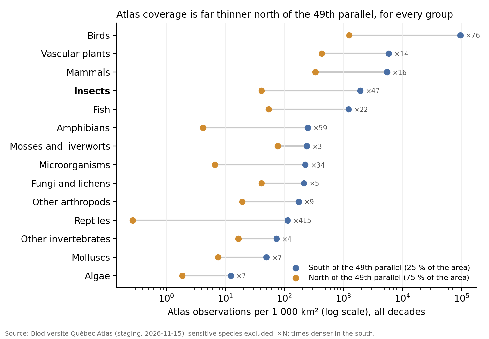

# Atlas contribution: first results (human annotations, no API cost)

**Track:** Atlas contribution potential (candidate second article). How the scores work: [`scores.md`](scores.md). Atlas tables: [`README.md`](README.md).
**Records:** the 231 valid records outside the held-out set. The 68 held-out records were not read; they are added later with `scripts/atlas_contribution_ceiling.py --include-heldout`, once the frozen held-out pass is done.
**Rebuild:** `uv run python scripts/atlas_contribution_ceiling.py --species-csv <main checkout>/artifacts/atlas/species_region_decade.csv` (GBIF answers cached in `data/gbif/atlas_contribution_cache.json`).

## In short

- **Most annotated taxa can be placed in the Atlas.** 90 % of the 273 taxon mentions reach the Atlas at some rank; 55 % match a taxon the Atlas holds, mostly at species rank.
- **Contribution and Fuster relevance measure different things.** They agree weakly overall (Spearman 0.34), and most of that agreement comes from one shared input, the north flag. On taxa they pull in opposite directions: no dataset rated High or Moderate by Fuster brings taxa new to the Atlas, while six rated Low or Excluded do (new lichens, rove beetles, mayflies, soil fungi, frog parasites).
- **Insects north of the 49th parallel are the Atlas's clearest gap:** 51 455 of 865 351 insect records (6 %) for 75 % of the province's area, 47 times sparser than in the south. Five of the 231 records hold insects there; the best candidate is a midge revision (record 363) with three species absent from the Atlas.
- **Recommendation:** the figure, the insect case and the Fuster comparison fit article 1 as the data-gap supplement (S3). A full contribution scoring is a second article, and only after an extraction that captures place names and whether records are deposited.

## Coverage north and south of the 49th parallel

Every group is sparser in the north, from 3 times (mosses and liverworts) to 76 times (birds) and 415 times (reptiles, few species reach the north). Insects are 47 times sparser: 41 records per 1 000 km² north of the 49th against 1 916 south. Built from the committed aggregates only (`coverage_north_south.csv`); sensitive species excluded.

## Matching the annotations to the Atlas

| | Count | Share |
|---|---|---|
| Taxon mentions (after splitting lists; 4 "and others" or hybrid labels set aside) | 273 | |
| Matched to an Atlas taxon | 149 | 55 % |
| Known to GBIF, absent from the Atlas extract | 44 | 16 % |
| Broad group only ("c. 30 lichen species", "fish") | 52 | 19 % |
| Unresolved or ambiguous | 28 | 10 % |

Usable mentions by rank: species 170, genus 8, family 1, order 12, class 2, broad group 52.

**What the unmatched items say.** The 28 unresolved mentions are mostly annotation text that is not a taxon ("presence only", "density", "plant communities"), typos ("Basam fir", "white spurce"), counts without a nameable group ("743 species (flora and fauna)", "c. 15 macrophyte species") and a few ambiguous answers held back while the GBIF homonym fix is in progress. The 44 absent mentions are of two kinds: **species at risk**, which the Atlas extract leaves out on purpose (caribou, wood turtle, lake sturgeon, American eel, Bicknell's thrush, little brown bat, butternut), and **taxa the Atlas has never recorded** (chironomid midges, rove beetles, a copepod, parasitic nematodes). The extract cannot tell them apart; an Atlas query on the sensitive list would.

Per record: 168 of the 231 records have an annotated taxon list; 153 have at least one usable taxon; 79 name a taxon at family rank or finer that the Atlas holds, which taxonomic novelty needs. Place: 31 records are flagged north of the 49th, 93 not north, 107 unknown. Years: 82 records.

## The four scores on the annotations

| Score | Records with a score | Mean | Median | Records at 0.5 or more |
|---|---|---|---|---|
| Taxonomic novelty | 79 | 0.10 | 0.00 | 7 |
| Spatial novelty | 118 | 0.18 | 0.00 | 28 |
| Temporal gain | 77 | 0.34 | 0.28 | 21 |
| Group gap | 153 | 0.11 | 0.00 | 5 |

Of the 153 records with at least one score, 99 fill no gap, 47 fill one and 7 fill two. None fills three.

Most annotated datasets are about taxa the Atlas already holds in numbers (median taxonomic novelty 0). Spatial novelty is, with the annotations, an indicator of the north flag. Temporal gain is the most common gap, because Atlas records are concentrated in the 2010s and 2020s.

**Sensitivity.** Changing any `k` threshold by ±50 % leaves dataset ranks almost unchanged (Spearman 0.91 to 1.00; top-20 overlap 85 to 100 %). The count of gaps filled moves more (Spearman 0.63 to 0.72 when `gap_cut` goes from 0.5 to 0.25 or 0.75), so it is a reading aid only. Scoring Atlas-absent taxa as new changes taxonomic novelty ranks somewhat (0.86); reading "not north" as "anywhere in Québec" changes almost nothing (0.98 on the count of gaps). Table: `ceiling_sensitivity.csv`.

## Comparison with the Fuster relevance (rule label)

128 records have both a Fuster rule label and at least one score.

| Fuster rule label | No gap filled | One gap | Two gaps | Total |
|---|---|---|---|---|
| High | 13 | 22 | 3 | 38 |
| Moderate | 21 | 11 | 2 | 34 |
| Low | 29 | 11 | 1 | 41 |
| Excluded | 13 | 1 | 1 | 15 |

Rank correlation with the label (Excluded < Low < Moderate < High), with 95 % bootstrap intervals:

| Score | With the final label | With the label before modulators | n |
|---|---|---|---|
| Gaps filled (count) | 0.34 [0.17, 0.50] | 0.24 [0.06, 0.41] | 128 |
| Spatial novelty | 0.40 [0.25, 0.54] | 0.30 [0.13, 0.47] | 118 |
| Temporal gain | 0.10 [−0.15, 0.32] | 0.11 [−0.12, 0.32] | 77 |
| Taxonomic novelty | −0.18 [−0.40, 0.06] | −0.32 [−0.54, −0.03] | 65 |
| Group gap | −0.13 [−0.30, 0.04] | −0.24 [−0.41, −0.07] | 128 |

How to read it:

- **The positive agreement is mostly built in.** The north flag is both one of the five Fuster modulators (it raises the label by one level) and our only place clue. 19 of the 30 north-flagged records with a label are rated High. Before modulators, the agreement on the count of gaps drops to 0.24.
- **On taxa, the two measures disagree.** Datasets the Fuster rules rate highly are long, multi-species surveys of well-known groups. Datasets that bring new taxa or under-sampled groups are short, single-site, often taxonomic notes, which the rules rate Low or Excluded. All six labelled records with taxonomic novelty at 0.5 or more are rated Low or Excluded (a seventh, a grapevine downy-mildew model, has no label).

### High Fuster relevance, little contribution

| Record | Title (shortened) | Why little contribution |
|---|---|---|
| 100 | Nest box recruitment and natal dispersal in a declining bird population (tree swallow) | Birds in the south, the Atlas's best-covered group and area; 2004–2020 is well covered |
| 83 | Large herbivores trigger spatiotemporal changes in forest plant diversity | 97 vascular plants in the south, 1995–2011: common species, well covered |
| 143 | A 249-year chronosequence of forest plots after successive fires, eastern boreal mixedwoods | Common boreal plants; the sampling years (1991–2009) are well covered, even though the stands are old |
| 240 | Marine mammal strandings in the St. Lawrence estuary and gulf | Mammals in the south are dense in the Atlas; 1994–2008 well covered |
| 276 | Lake sturgeon management in the lower St. Lawrence, 1910s to present | Species at risk: absent from the extract, so no taxonomic score; the annotated years (1995–2008) are well covered |
| 104 | Compensatory conservation measures for an endangered caribou population | Same blind spot: caribou is a sensitive species |

Ecological reading: these are valuable studies, and Fuster rates them for what they are (long, abundance or density data, large areas). For the Atlas, though, they mostly repeat what it already holds, except for species at risk, which the scores cannot see by design.

### Low or Excluded Fuster relevance, real contribution

| Record | Title (shortened) | Fuster | Contribution |
|---|---|---|---|
| 13 | *Aspicilia bicensis*, a new sterile lichen from eastern Canada | Low | New lichen (taxonomic 0.70), most under-sampled group (fungi and lichens, 0.77) |
| 176 | Relative abundance and diversity of Endogonaceae in a Québec orchard soil | Excluded | Mycorrhizal fungi rare in the Atlas (0.71), under-sampled group (0.65) |
| 356 | New Staphylinidae records from New Brunswick, an addition to the fauna of Québec | Low | Rove beetles almost absent from the Atlas (0.85) |
| 382 | Additions to the Canadian Ephemeroptera | Low | Mayflies rare in the Atlas (0.52) |
| 418 | Nematode parasites of northern leopard frogs | Excluded | Parasitic nematodes rare in the Atlas (0.76) |
| 396 | Two *Diaptomus* copepods in shallow Québec lakes | Low | Records from 1978–1981, a decade the Atlas lacks for these groups (temporal 1.0) |
| 248 | Food of double-crested cormorants in the St. Lawrence | Low | 1994–1996 diet data (temporal 0.83) |
| 343 | Future trends of Québec's boreal birds | Low | North of the 49th, where birds are 76 times sparser (spatial 1.0) |

Ecological reading: taxonomic notes, new records and small surveys of fungi, lichens, insects and invertebrates are exactly what an occurrence atlas lacks, and exactly what the Fuster rules (duration, extent, data type) rate low. Old short surveys are similar: short, hence Low, but from decades the Atlas barely covers. One caution from record 392 (arctic and red fox in the eastern Subarctic): it is flagged "not north", so it is scored against the south. The annotations' place information is too crude for region-level conclusions.

## Case study: insects in northern Québec

**What the Atlas holds.** 865 351 insect records in the administrative regions, of which 51 455 (6 %) north of the 49th parallel, which covers 75 % of the province (1 256 070 of 1 680 833 km²). That is 41 records per 1 000 km² in the north against 1 916 in the south. Insects are also an under-sampled group overall (74 records per known species, against a median of 152 across groups).

**What the corpus offers.** 26 of the 231 records hold insect taxa. Five are flagged north of the 49th:

| Rank | Record | Title (shortened) | Fuster | Insect content | Taxonomic novelty | Temporal gain |
|---|---|---|---|---|---|---|
| 1 | 363 | A new *Rheocricotopus* species and a review of *Parametriocnemus* (Chironomidae) | Moderate | 3 midge species, all absent from the Atlas | 1.00 | no years |
| 2 | 129 | Genetic loci of two spruce budworm parasitoids (*Apanteles*, *Glypta*) | High | 2 species, few northern records | 0.16 | 0 (2014) |
| 3 | 80 | Trait adaptation in ant communities of extreme environments | High | 37 ant species, named only as a count | not judged | 0 (2017) |
| 4 | 38 | Animal community assembly after logging in the boreal forest | High | 439 beetle species (named as counts), with mammals | not judged | 0.50 (2007–2011) |
| 5 | 208 | Benthic coastal communities in a sub-Arctic area | High | Insects are part of a "benthic community" label | not judged | no years |

Ranking: records known to be north first, then the share of their taxa that are insects, then the mean of taxonomic novelty and temporal gain (spatial novelty and group gap are the same for all of them). For this case, insect species absent from the Atlas count as new, because few insects have a legal status in Québec.

Reading: record 363 adds species the Atlas has never recorded; record 38 is the largest insect dataset in the north (439 beetle species over five years, deposited on Dryad) and would add volume where the Atlas has almost none, but the annotations name its beetles only as counts, so its taxonomic novelty cannot be judged; record 129 is genetic data, which an occurrence atlas cannot use unless the sampling records come with it. The next records on the list are southern (weevils in vineyards in the 1990s, a honeysuckle aphid first recorded in the 1970s, rove beetles): useful for temporal and taxonomic gaps, not for the northern gap.

The corpus itself reflects the gap: only 5 of 231 records hold insects north of the 49th. A targeted harvest (insect taxa, northern places) is the way to find more, which is what the extraction schema is for.

## Limits

- Only the human annotations are scored here. No extraction was run (no API cost on this track yet), so nothing is known yet about how well an LLM recovers these inputs.
- Places come from one flag; region-level spatial novelty awaits extracted place names.
- Sensitive species are invisible to the scores (see `scores.md`).
- Whether records are actually deposited and loadable is not in the annotations, and it decides whether a dataset can add anything.
- The scores have not had the planned ecological review.

## Recommendation: article 1 supplement, then a second article

**For article 1 (data-gap supplement S3):** the coverage figure, the insect case (Atlas numbers plus the five northern records) and the two divergence tables. They make one point the Fuster relevance cannot: what is "relevant" in general is not what fills the Atlas's gaps, and the gaps are measurable. This needs no new runs.

**For a second article:** contribution scoring as a method, once (1) the contribution schema is run on the corpus to get place names, years and whether occurrence records are deposited, (2) the held-out records are added, (3) the sensitive-species blind spot is handled with the Atlas sensitive list, and (4) the scores have had an ecological review. On the annotations alone, place is binary and only 79 records support taxonomic novelty: too thin for a stand-alone paper.

## Files

| File | Content |
|---|---|
| `ceiling_scores.csv` | Four scores, gaps filled, groups, place, decades and Fuster label per record |
| `ceiling_match_rates.csv` | Match rates per mention and per record |
| `ceiling_sensitivity.csv` | Threshold and structural sensitivity |
| `ceiling_score_correlations.csv` | Correlations between the four scores |
| `ceiling_fuster_spearman.json`, `ceiling_fuster_crosstab.csv`, `ceiling_fuster_premodulator_crosstab.csv` | Comparison with the Fuster label |
| `case_insects_north.csv` | Insect case ranking (26 records) |
| `group_effort.csv`, `coverage_north_south.csv`, `fig_coverage_north_south.png` | Atlas coverage from the aggregates |
| `artifacts/atlas/ceiling_taxon_matches.csv` (git-ignored) | Per-taxon matches, which reveal per-species Atlas status |
